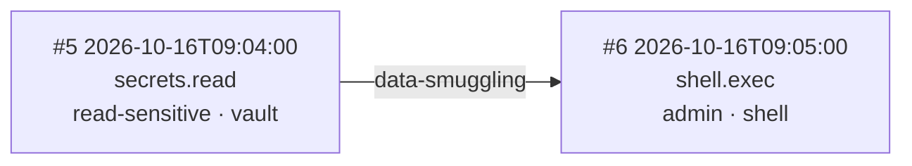

# tool-sequence-analyzer

Detect **privilege-escalation patterns** across AI agent tool-call sequences.

Point it at a JSONL log of tool calls and it flags the dangerous shapes:
reads that feed cross-system writes, quiet reads that precede privileged
writes, and data smuggled from a tool *result* into a privileged tool's *args*.

## Problem

AI agents call dozens of tools per session. A single call looks innocent —
`crm.get_contact`, then later `email.send` — but the *sequence* can be a
privilege escalation: sensitive data read from one system, written out
through another. `tool-sequence-analyzer` gives you a fast, dependency-free
way to audit those sequences before they become incidents.

## Install

Zero dependencies — Python 3.8+ stdlib only.

```bash
git clone https://github.com/Iceman2050/tool-sequence-analyzer.git
cd tool-sequence-analyzer
```

## Usage

Input log: JSONL, one JSON object per line:

```json
{"ts": "2026-10-16T09:00:00", "tool": "crm.get_contact",
 "args": {"system": "crm", "contact_id": "c-118"},
 "result_summary": "Contact record for Ada Okafor ..."}
```

Privilege levels come from a `tools.yaml` you provide (a sensible default
ships as `default_tools.yaml`):

```yaml
default_level: read-low
tools:
  crm.get_contact: read-sensitive
  email.send: write-sensitive
  shell.exec: admin
```

Run:

```bash
python3 -m toolseq --log tests/fixtures/planted-chain.jsonl --out report.md
```

## Detection rules

| Rule | Pattern | Why it's dangerous |
|---|---|---|
| `cross-boundary` | `read-sensitive` → `write-sensitive` on a **different** system | data read from CRM exfiltrated via email/SMS |
| `escalation` | `read-low` → `write-sensitive` | a trivial read precedes a privileged write |
| `data-smuggling` | `admin` tool whose args contain a token first seen in an earlier tool **result** | credentials/PII lifted from a read and passed to `shell.exec`, `iam.grant`, … |

Chains are ranked by severity and each ships with a Mermaid flowchart.

## Example output

```
scanned 7 events -> 3 suspicious chain(s)
  1. [data-smuggling] score=50 :: admin tool 'shell.exec' at #6 has args containing
     'whsec_7HkP2mQx9vRt4YzA' first seen in result of 'secrets.read' at #5
  2. [cross-boundary] score=20 :: read-sensitive 'crm.get_contact' (system 'crm') at #0
     feeds write-sensitive 'email.send' (system 'mail') at #2
  3. [escalation] score=10 :: read-low tool 'fs.read' at #3 precedes
     write-sensitive tool 'db.write' at #4
report written to report.md
```

And in `report.md`, each chain includes a diagram like:



## Tests

```bash
python3 -m unittest discover -s tests
# 14 tests — planted-chain (all 3 rules fire), benign (clean),
# empty log, single call, malformed lines, unknown tools
```

## License

MIT — see [LICENSE](LICENSE).

---

## Built by Ingenious AI

**tool-sequence-analyzer** is built and maintained by **Ingenious AI**.

Get early access to our AI safety & compliance platforms:

- [DisclosureGuard](https://wa.me/5016691053?text=Hi%20Ingenious%20AI!%20I%20want%20early%20access%20to%20DisclosureGuard) — AI disclosure compliance
- [ModelMinder](https://wa.me/5016691053?text=Hi%20Ingenious%20AI!%20I%20want%20early%20access%20to%20ModelMinder) — model deprecation radar
- [TermsWatch](https://wa.me/5016691053?text=Hi%20Ingenious%20AI!%20I%20want%20early%20access%20to%20TermsWatch) — AI vendor terms watcher
- [Vibe-Code Audit](https://wa.me/5016691053?text=Hi%20Ingenious%20AI!%20I%20want%20early%20access%20to%20Vibe-Code%20Audit) — vibe-code security audit
- [Rogue-Agent Defense](https://wa.me/5016691053?text=Hi%20Ingenious%20AI!%20I%20want%20early%20access%20to%20Rogue-Agent%20Defense) — rogue agent protection
- [BreachHunter](https://wa.me/5016691053?text=Hi%20Ingenious%20AI!%20I%20want%20early%20access%20to%20BreachHunter) — breach detection
- [ChatBreaker](https://wa.me/5016691053?text=Hi%20Ingenious%20AI!%20I%20want%20early%20access%20to%20ChatBreaker) — conversational AI testing
- [Agent Flight Recorder](https://wa.me/5016691053?text=Hi%20Ingenious%20AI!%20I%20want%20early%20access%20to%20Agent%20Flight%20Recorder) — hash-chained agent logging
- [Agent Auth Gateway](https://wa.me/5016691053?text=Hi%20Ingenious%20AI!%20I%20want%20early%20access%20to%20Agent%20Auth%20Gateway) — agent budget caps & kill switch
- [DomainGuard](https://wa.me/5016691053?text=Hi%20Ingenious%20AI!%20I%20want%20early%20access%20to%20DomainGuard) — domain-impersonation defense
- [ContentCraft AI](https://wa.me/5016691053?text=Hi%20Ingenious%20AI!%20I%20want%20early%20access%20to%20ContentCraft%20AI) — AI content platform


> Built by Ingenious AI with Muse — get free tokens with invite code `2HCQH1`
